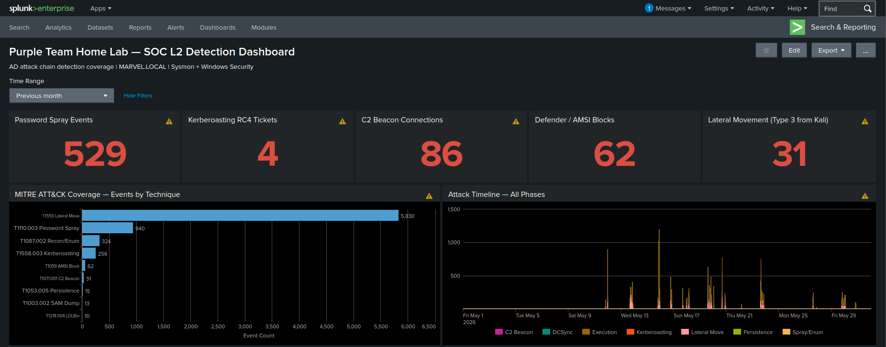
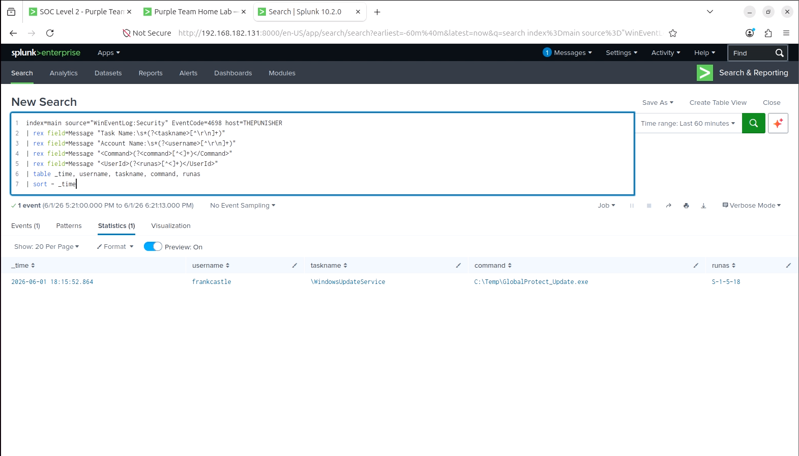
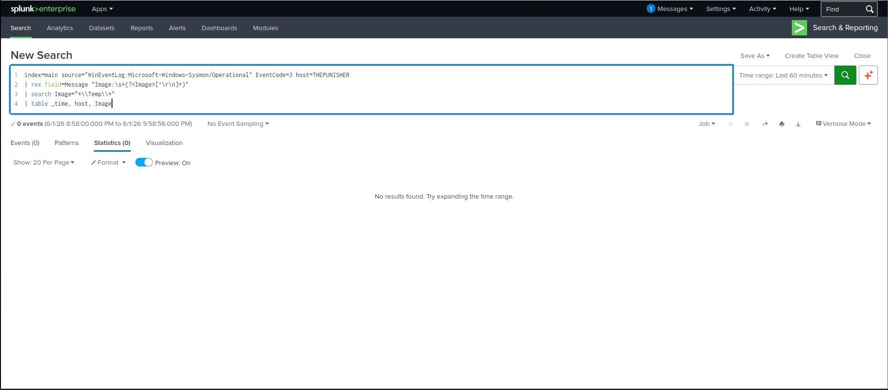
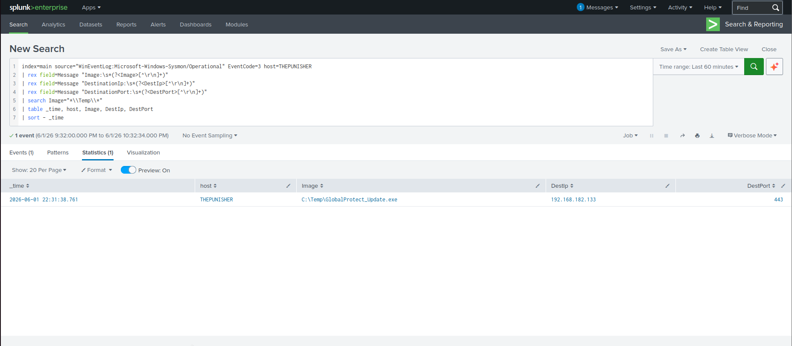

# Purple Team Home Lab — Active Directory Detection Engineering

A self-built Active Directory lab where every attack is run, detected in Splunk, then
stress-tested for what default tooling misses. The gap is then closed and re-proven.

> This documents **Lab v2**, the Sysmon + Splunk baseline. The NDR and EDR layers were added
> in [v3](../v3/). [v4](../v4/), a rebuild on a hardened baseline, is scoped as a design
> document and not yet built. Repo entry point: [root README](../README.md).

> **This page is preserved as written, before the detections were measured against real
> data.** Several queries here and in [`03_detection_playbook.md`](03_detection_playbook.md)
> were later found wrong and corrected in [`detections/`](../detections/) and
> [v3](../v3/): the LSASS access-mask list matched mostly benign masks and omitted
> `0x1F3FFF`, the one the attack actually used; and the "Excellent / Low-FP" coverage grades
> for Kerberoasting and spray did not survive measurement. The difference between this page
> and v3 is the point, so the originals are left unedited and the corrections are marked
> where they apply.

This page is the 2-minute scan and the full playbooks are linked below.

[`Portfolio_OnePager_v2.pdf`](Portfolio_OnePager_v2.pdf) is a one-page summary **of v2 as it
stood in June 2026**, kept with the rest of this version rather than updated. Its figures are
v2 figures — 9 Sigma rules, an 18-entry Navigator layer, the eight-phase chain, Splunk and
Sysmon only — and they no longer match the repository, which now ships 13 Sigma rules across
15 scored techniques and adds Zeek, Suricata and Wazuh. For the current state read the
[root README](../README.md); for the full write-up, the
[32-page v3 report](../v3/Purple_Team_Report_v3_EN.pdf).

## What this covers

- **Detection engineering.** 10 host detections shipped as
  [Sigma rules](../detections/sigma/sigma_rules.yml) and a deployable
  [Splunk pack](../detections/splunk/purple_lab), version-controlled. Two of its detections
  run on CIM data models; see [`detections/README.md`](../detections/README.md) for which of
  those this lab's forwarder configuration actually populates.
- **Adversary emulation.** 8 MITRE ATT&CK techniques across a full AD kill chain, Defender
  left on throughout.
- **The purple loop.** Attack, detect, find the detection gap, fix it, re-run to prove the
  fix works.

## Lab

```
               Kali (attacker) 192.168.182.133
                        │
      ┌─────────────────┼──────────────────┐
      │                 │                  │
HYDRA-DC .135      THEPUNISHER .137     SPIDERMAN .138
Win Server 2022    Win 10 endpoint      Win 10 endpoint
AD DS / MARVEL.LOCAL    │                  │
      └────────── Sysmon + Splunk UF ──────┘
                        │
                Splunk SIEM 192.168.182.131
```

Five VMs, VMware NAT `192.168.182.0/24`. Sysmon and a Splunk Universal Forwarder on every
Windows host, audit policy enforced via GPO.

## MITRE ATT&CK coverage

| Phase          | Technique         | Tooling                 | Detection               | Prevention                  |
| -------------- | ----------------- | ----------------------- | ----------------------- | --------------------------- |
| Recon          | T1046 / T1087.002 | nmap, kerbrute, Certipy | 4768 err 0x6 burst      | Segmentation                |
| Initial Access | T1110.003         | kerbrute spray          | 4771 multi-user/source  | FGPP + lockout              |
| Execution      | T1218.004         | InstallUtil + .NET      | LOLBin from user path   | AppLocker / WDAC            |
| Cred Access    | T1558.003         | GetUserSPNs             | 4769 RC4 (0x17)         | AES + strong pwd + gMSA     |
| Lateral / C2   | T1071.001         | Sliver mTLS             | behavioral beacon       | AppLocker + egress filter   |
| Cred Access    | T1003.002 / .006  | reg save, DCSync        | reg-save combo / 4662   | Defender + Credential Guard |
| Persistence    | T1053.005         | schtasks                | 4698 SYSTEM + user path | Restricted local admin      |
| C2 / Exfil     | T1071.001 / T1041 | Sliver beacon           | Sysmon EID3 (C:\Temp fix) | TLS inspection            |

Full coverage matrix and per-technique detection cards:
[`03_detection_playbook.md`](03_detection_playbook.md). The
[rendered ATT&CK Navigator layer](screenshots/09_attack_navigator.svg) is this version's
render and shows the v2 techniques only; the
[JSON source](../detections/attack_navigator_layer.json) has since been extended to cover
v3 as well, so it carries LSASS access, Pass-the-Ticket and the WinRM pivot that this SVG
does not.

## Headline finding: the C2 detection gap

A Sliver implant beaconed over mTLS/443 from `C:\Temp` and default Sysmon did not record the
network connection. `NetworkConnect` is not logged for a bare `C:\Temp` out of the box.

The naive fix is to add the implant's filename to a watchlist, which dies the moment the
binary is renamed. The fix shipped here is behavioral: flag any process running from a
user-writable path (`C:\Temp`, `AppData`, `ProgramData`) that initiates egress, then confirm
with beacon interval and jitter analysis. See
[Sigma rule 7](../detections/sigma/sigma_rules.yml) and the CIM `tstats` version in the
Splunk pack.

## Blue-team result (Defender on, not staged)

Credential dumping was stopped by four layers, with no successful dump:

1. **AMSI** blocked the Mimikatz `lsadump::dcsync` call in-memory
   (`ScriptContainedMaliciousContent`) before the command executed.
2. **Defender** real-time scan flagged the `reg save HKLM\SAM` behaviour (EC1116/1117).
3. **`reg save HKLM\SYSTEM` was denied** ("Access is denied") while the SAM and SECURITY
   hives saved from the same shell. Why only that one failed is not established; see Phase 6
   of [`02_attack_playbook.md`](02_attack_playbook.md).
4. Without the SYSTEM hive there is no bootkey, so **local `secretsdump` failed**
   ("SYSTEM hive or bootkey required").

DCSync never landed. The control that demonstrably worked was AMSI stopping the tool. The
missing bootkey did the rest, though what denied the SYSTEM hive is not established.

The AD point from the walkthrough: a Domain Admin reaches `DS-Replication-Get-Changes` only
indirectly, through nested `BUILTIN\Administrators` on the DC. Remove that nesting and
DCSync via a DA breaks. The durable fix is tiering, not AV signatures.

## Screenshots

### 00 — SOC detection dashboard

[](screenshots/06_dashboard.png)
> Splunk dashboard for the run: KPI tiles (password-spray events, Kerberoasting RC4 tickets,
> C2 beacon connections, Defender/AMSI blocks, attacker network logons), a MITRE ATT&CK
> coverage bar chart by technique, and an attack timeline across all phases.
>
> Two things in this image are worth naming rather than hoping nobody notices. Every panel
> carries a search warning, and the tiles and the bar chart do not agree — the
> "Lateral Movement" tile reads 31, which is the same number the chart gives `T1071.001 C2
> Beacon`, while the "C2 Beacon" tile reads 86 and matches nothing on the chart. The tiles and
> the chart were written as separate searches counting different things under similar labels,
> which is exactly the sort of dashboard that looks authoritative and misleads. It is kept as
> taken, like the rest of v2; the lesson is that a KPI tile needs the same scrutiny as a
> detection rule, and it did not get it here.

### 01 — Password spray (T1110.003)

[](screenshots/01_password_spray.png)
> Splunk `4771` correlation: single source (`192.168.182.133`), 3 unique accounts in a
> 5-minute window. No lockout triggered, because the spray sends one bad attempt per account.

### 02 — Kerberoasting, RC4 ticket (T1558.003)

[](screenshots/02_kerberoasting.png)
> `4769` with `Ticket_Encryption_Type=0x17` (RC4-HMAC) for `SQLService`. On a modern AES
> domain, RC4 service tickets for user-SPNs are anomalous by definition.

### 03 — Authenticated network logons from the attacker (T1021.002)

[](screenshots/03_lateral_movement.png)
> `4624` Logon Type 3 from Kali (`.133`) to THEPUNISHER (`.137`) and the DC: the
> authenticated-access footprint of the post-compromise tooling. The lateral movement itself
> ran over Sliver C2 (screenshot 05); `secretsdump` against the DC was blocked at SMB and
> failed locally, as above.

### 04 — Defender and AMSI block Mimikatz (T1003.001)

[](screenshots/04_defender_amsi.png)
> `Trojan:PowerShell/Powersploit.C` blocked at the AMSI layer before execution. Alert level
> Severe. Defender was on throughout the lab.

### 05 — C2 beacon from C:\Temp (T1071.001)

[](screenshots/05_c2_beacon.png)
> Sysmon EID 3: `C:\Temp\GlobalProtect_Update.exe` → `192.168.182.133:443` (Sliver mTLS).
> Default Sysmon missed this. The SwiftOnSecurity baseline covers `C:\Users` and
> `C:\ProgramData` but not a bare `C:\Temp`. The detection keys on location, not filename, so
> a renamed binary still trips it.

### 06 — Persistence, scheduled task as SYSTEM (T1053.005)

[](screenshots/07_persistence.png)
> `4698` on THEPUNISHER: task `\WindowsUpdateService` running
> `C:\Temp\GlobalProtect_Update.exe` as `S-1-5-18` (SYSTEM), created by `frankcastle`. A
> SYSTEM task launching a binary from a user-writable path is the persistence signature.

## Gap, fix, re-prove

The `C:\Temp` NetworkConnect gap:

| Before the fix | After the fix |
| -------------- | ------------- |
| [](screenshots/08a_gap_demo.png) | [](screenshots/08b_fix_demo.png) |
| Sysmon EID 3 for `C:\Temp`: 0 events. Default config does not log NetworkConnect there. | Same search: 1 event, `C:\Temp\GlobalProtect_Update.exe` → `192.168.182.133:443`, the C2 beacon. |

The prevention fixes, re-proven:

- [Account lockout](screenshots/10_fix1_lockout.png). With lockout enabled the spray trips
  `4740` (fcastle locked out) instead of running free.
- [AES-only Kerberos](screenshots/10_fix2_aes.png). `4769` for `SQLService` flips from
  `0x17` (RC4) to `0x12` (AES-256) across the timeline, so the *default* roast now comes back
  AES. Read carefully: this narrows the etype of the issued ticket, it does not prove RC4 is
  blocked. v3 measured the difference — the account still held an RC4 key and a `4768` TGT
  for it came back `0x17` on request, so an attacker who asks for the downgrade explicitly
  still gets it. Preferring AES and enforcing AES-only are different postures. Removing the
  RC4 key (`msDS-SupportedEncryptionTypes` set to AES-only) is what actually closes it.
- [AppLocker deny `C:\Temp`](screenshots/10_fix3_applocker.png). AppLocker `8004`:
  `GLOBALPROTECT_UPDATE.EXE was prevented from running`.

## Repo map

```
purple-team-lab/
├── detections/                     <- repo root, shared across versions
│   ├── sigma/sigma_rules.yml       <- 10 host rules, vendor-agnostic
│   ├── sigma/v3_ndr.yml            <- 3 Zeek network rules, added in v3
│   ├── wazuh/local_rules.xml       <- 5 Wazuh rules, added in v3
│   ├── splunk/purple_lab/          <- deployable Splunk app (+ cim-acceleration/)
│   └── attack_navigator_layer.json <- MITRE ATT&CK coverage layer
├── config/sysmonconfig.xml         <- Sysmon config incl. the C:\Temp NetworkConnect fix
├── v2/                             <- this version
│   ├── README.md                   <- you are here
│   ├── 01_lab_setup.md             <- AD lab build (DC, endpoints, Sysmon, Splunk)
│   ├── 02_attack_playbook.md       <- 8 phases, commands, MITRE mapping
│   ├── 03_detection_playbook.md    <- detection cards, SPL, IR runbook, hardening
│   ├── lab_issues.md               <- build and debug log (GPO/auditpol, ACLs, forwarder)
│   ├── COMMAND_REFERENCE.md        <- command quick-reference
│   └── screenshots/                <- 12 detection screenshots + ATT&CK Navigator layer (SVG)
├── v3/                             <- NDR + EDR layers, 7 case files, technical report
└── v4/                             <- design document only, not yet built
```

## Scope and caveats

This is a lab, not production.

- **The account design is wrong, and it changes how the chain should be read.** Four of the
  six accounts are Domain Admins, including `fcastle`, which the Phase 2 spray recovers. So
  the domain is owned at phase 2, and the Kerberoast in Phase 4 goes from one Domain Admin
  to another. The eight phases are not a privilege-escalation path; each one is run to
  produce the telemetry for that technique, and the detections are what the lab is about.
  [v3](../v3/) fixes the entry point: the spray lands on `pparker`, a standard domain user,
  who then Kerberoasts a Domain Admin SPN 98 seconds later, which is a real escalation.
  [v4](../v4/) moves the service account to a gMSA.
- **Defender is enabled, but three paths are excluded and UAC is off on one host.** The
  exclusions are `C:\Temp`, `C:\Windows\` — the entire Windows folder — and
  `C:\Windows\Tasks`, set by GPO ([`01_lab_setup.md` §7](01_lab_setup.md)), so payload
  delivery is reproducible on camera; the AppLocker fix in Segment 10 addresses the
  `C:\Temp` path. UAC is also disabled on THEPUNISHER (`EnableLUA=0`, `lab_issues.md` #5).
  Both make the attack easier, which makes the blue-team result below stronger rather than
  weaker — but "Defender on, not staged" should be read as "Defender on, with these
  exclusions and UAC off", not as a hardened host. [v3](../v3/) removed the exclusions
  entirely.
- Kali's SMB/RPC (445/135) is firewall-filtered from all three Windows hosts (see the
  connectivity matrix in `01_lab_setup.md`), so impacket attacks cannot run directly from the
  attacker and pivot through an endpoint's authenticated session instead. That is the
  realistic path anyway.
- Single domain, single forest. At v2 there is no NDR or EDR layer; network detection
  (Zeek + Suricata, JA4 fingerprinting) and host EDR (Wazuh) arrive in [v3](../v3/).
