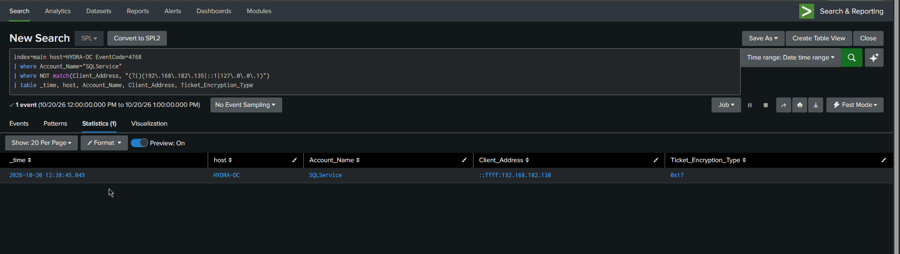
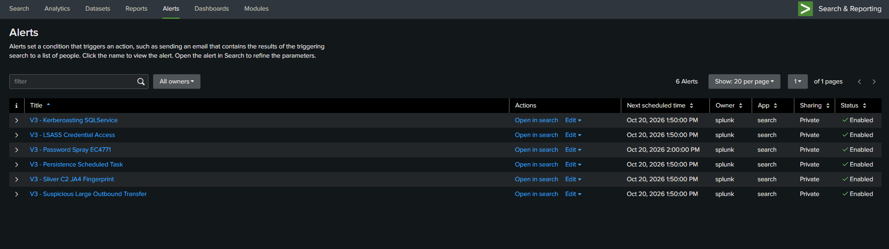

# Lab v3 — Network Detection and Host EDR Layers

> The full technical report is in Serbian:
> [`Purple_Team_izvestaj_v3_SR.pdf`](Purple_Team_izvestaj_v3_SR.pdf).
> This page is the English summary.
> Repo entry point: [root README](../README.md).

v3 adds two detection layers on top of the [v2](../v2/) Sysmon + Splunk baseline, taking
the lab to five: Windows Security log, Sysmon, Splunk SIEM, Wazuh EDR, and Zeek + Suricata
network detection. The same Active Directory kill chain was re-run and each phase evaluated
against all five layers.

## Infrastructure

| Host | Address | Role |
| ---- | ------- | ---- |
| HYDRA-DC | `.135` | Windows Server 2022 — AD DS, `MARVEL.LOCAL` |
| SPIDERMAN | `.138` | Windows 10 endpoint |
| THEPUNISHER | `.137` | Windows 10 endpoint |
| Splunk | `.131` | Splunk 10.2 SIEM |
| Wazuh | `.150` | Wazuh 4.12 manager — 3 Windows agents |
| security-vm | `.151` | Zeek + Suricata |
| Kali | `.133` | Attacker |

## Kill chain and detection coverage

| Phase | Technique | Detected by |
| ----- | --------- | ----------- |
| Password spray | T1110.003 | Windows `4771`, Zeek `kerberos.log`, Suricata `krb5` |
| Kerberoasting | T1558.003 | Windows `4769`, Suricata `krb5`, Suricata `weak_encryption` |
| Pass-the-Ticket | T1550.003 | Windows `4624` type 3, Zeek `kerberos.log` |
| Lateral movement (WinRM) | T1021.006 | Zeek `conn.log` port 5985, Suricata `REQUEST_AUTH_UNRECOGNIZED` |
| LSASS access | T1003.001 | Sysmon EID 10 (THEPUNISHER only — SPIDERMAN is a deliberate blind spot) |
| Scheduled task persistence | T1053.005 | Windows `4698`, Wazuh rule `60228` |
| C2 beaconing | T1071.001 | Zeek `ssl.log` — JA4 TLS fingerprinting |

## Findings

**Network layer caught a spray attempt the endpoint log missed.** Zeek `kerberos.log`
recorded seven accounts tried from a single non-domain source inside 0.6 seconds: one
succeeded (`pparker`), four were rejected at pre-authentication, and two failed otherwise —
one unsupported encryption type (`Guest`), one unknown principal (`jsmith`). Windows `4771`
logged only five of the six failures: an unknown-principal attempt produces no `4771`, so
the network layer saw one spray attempt that never reached the endpoint log.

**One JA4 fingerprint linked two compromised endpoints.** Both endpoints beaconed to the
attacker host over TLS sharing an identical Sliver JA4 client fingerprint
(`t13i131000_f57a46bbacb6_e5728521abd4`) — 69 sessions from SPIDERMAN, 27 from THEPUNISHER.
The fingerprint survives a binary rename, so the detection does not depend on a filename or
hash.

**Wazuh scheduled-task alerting does not separate malicious from benign.** The `\Updater`
persistence task created on THEPUNISHER fired rule `60228` at level 4 — the same rule and
the same severity as a legitimate OneDrive update task created on the same host earlier
that day. Task creation is alerted on; task *content* is not evaluated.

## Detection screenshots

All times are from the 20 Oct 2026 run. Zeek queries parse the raw TSV with `rex` to show
log structure; in production the Zeek TA extracts these fields (see v4).

### 01 — Password spray, network view (T1110.003)

> Zeek `kerberos.log`: seven accounts from `192.168.182.133` in 0.6 s — `pparker` succeeds,
> `jsmith` fails as unknown principal (no Windows `4771` for that one, so the network layer
> sees an attempt the endpoint log misses).

### 02 — Password spray, endpoint view (T1110.003)

> Windows `4771` correlation: single source `192.168.182.133`, five distinct accounts failing
> pre-authentication.

### 03 — Kerberoasting, AES service ticket (T1558.003)

> `4769` for `SQLService`, `Ticket_Encryption_Type=0x12` (AES-256) requested by `pparker`
> from `192.168.182.133`. v3 uses AES, not the RC4 (0x17) of v2.

### 04 — Kerberoasting, TGT request from endpoint (T1558.003)

> `4768` TGT for `SQLService` sourced from `192.168.182.138` (SPIDERMAN), `0x17` — the ticket
> request that precedes the roast.

### 05 — Lateral movement over WinRM (T1021.006)

> Zeek `conn.log`: three connections `192.168.182.138 → 192.168.182.137` on port `5985`
> (WinRM) — SPIDERMAN pivoting to THEPUNISHER.

### 06 — Suricata application-layer anomalies

> `weak_encryption` on the Kerberos exchanges and `REQUEST_AUTH_UNRECOGNIZED` during the
> 12:42–12:43 WinRM pivot.

### 07 — LSASS access, the real credential theft (T1003.001)

> Sysmon EID 10 on THEPUNISHER: `notepad.exe` accessing `lsass.exe` with `GrantedAccess
> 0x1F3FFF` (CRITICAL). The query excludes `MsMpEng.exe`/Defender, so Defender's own routine
> LSASS access is filtered out and the injected `notepad.exe` is what surfaces.

### 08 — Persistence, scheduled task (T1053.005)

> `4698` on THEPUNISHER: task `\Updater`, `powershell.exe -WindowStyle Hidden -c IEX(...
> update.ps1)` — the download cradle visible in the command fields.

### 09 — C2 beaconing, JA4 fingerprint (T1071.001)

> Zeek `ssl.log` filtered on the Sliver JA4 `t13i131000_f57a46bbacb6_e5728521abd4`:
> 69 beacons from SPIDERMAN and 27 from THEPUNISHER to the C2 at `192.168.182.133`.

### 10 — Detection content shipped as alerts

> Six v3 saved alerts, all enabled: spray, Kerberoasting, LSASS, persistence, JA4 C2, and
> large outbound transfer.

## Known gaps carried into v4

- The lab runs on a default-ish Windows baseline, so no attack had to work through
  hardening. v4 rebuilds on a CIS baseline and re-runs the chain for a before/after
  coverage matrix.
- Account lockout is enforced (5 failures), but the spray sent a single attempt per
  account and so never reached the threshold — the standard way password spraying evades
  lockout. The weaker control is the 7-character minimum password length; v4 raises it.
- `SQLService` is a human-managed account with an SPN, which is what made Kerberoasting
  possible.
- The Wazuh scheduled-task rule gap above is unfixed here.
