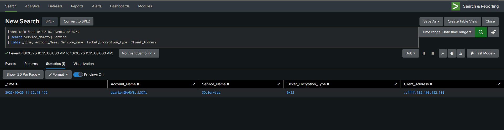
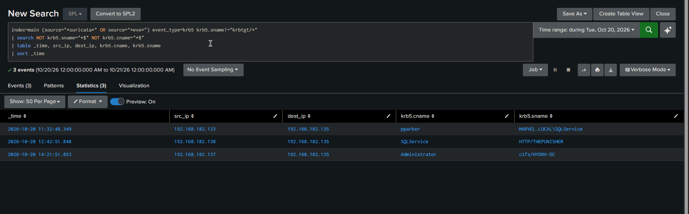

# CASE-02 — Kerberoasting of a Domain Admin service account

| | |
| --- | --- |
| Alert | `V3 - Kerberoasting` (Splunk, scheduled) and Suricata `krb5` |
| Fired | 20 Oct 2026, 11:32 |
| Severity | High |
| MITRE | [T1558.003 — Kerberoasting](https://attack.mitre.org/techniques/T1558/003/) |
| Verdict | True positive. Domain Admin credential recovered offline. |
| Handed from | [CASE-01](CASE-01-password-spray.md) |

## 1. What the alert showed

A Kerberos service ticket (`4769`) requested for the SPN `SQLService`, by `pparker`, from
`192.168.182.133`. That address is the non-domain host CASE-01 identified, and `pparker` is
the account the spray recovered 98 seconds earlier.



## 2. Questions

1. Is `SQLService` an account with an SPN, and what rights does it hold?
2. Which encryption type was the ticket issued with, and does that matter here?
3. Did the RC4 rule fire? If not, what did catch it?
4. Was the hash actually crackable, or is this a failed attempt?
5. Was the recovered credential used, and where?

## 3. Queries

Ticket request, encryption type and source:

```spl
index=main host=HYDRA-DC EventCode=4769
| search Service_Name=SQLService
| table _time, Account_Name, Service_Name, Ticket_Encryption_Type, Client_Address
```

Account rights, on the DC:

```
net group "Domain Admins" /domain
Get-ADUser SQLService -Properties ServicePrincipalName, Description
```

Network view, keyed on the pattern rather than the source address. Suricata `krb5`,
filtered to service tickets whose SPN is neither `krbtgt` nor a machine account:



## 4. Findings

| | |
| --- | --- |
| SPN requested | `SQLService` |
| Requested by | `pparker`, the account compromised in CASE-01 |
| Source | `192.168.182.133`, non-domain |
| Encryption type | `0x12` (AES-256) |
| `SQLService` group membership | **Domain Admins** |
| Password storage | also present in the account's AD `Description` field |
| Outcome | hash cracked offline, hashcat mode 19700 |

Three things follow from this.

**The canonical detection did not fire.** The RC4 rule keys on
`Ticket_Encryption_Type = 0x17`, which is what the classic roast produces. This ticket was
`0x12`. Counting every `4769` in this lab over 30 days: 1,649 tickets, all `0x12`, zero RC4.
The rule is scheduled, it appears in the coverage table, and it has never had an input. See
finding 5 in [`v3/README.md`](../README.md).

**What caught it was the SPN pattern, not the encryption type.** Suricata `krb5` and the
Zeek rule filter on service tickets whose SPN belongs to neither `krbtgt` nor a machine
account. That survives a domain on AES. The same Suricata view surfaced two more tickets in
the same chain: `SQLService → HTTP/THEPUNISHER`, the cracked account being reused, and
`Administrator → cifs/HYDRA-DC`.

**The target was the wrong kind of account.** `SQLService` is a human-managed account that
holds Domain Admin and carries an SPN. A roast against it does not escalate from a
low-privilege service account, it goes straight to Tier 0. The password was also written
into the account's AD `Description` field, which is a second and independent exposure
([T1552.001](https://attack.mitre.org/techniques/T1552/001/)) that needs no cracking at all.

## 5. Verdict

True positive. A standard domain user, compromised two minutes earlier, requested a service
ticket for a Domain Admin SPN and cracked it offline. The domain is compromised at this
point.

## 6. What the account did next

The recovered `SQLService` credential was used to request a TGT from SPIDERMAN at 12:38,
which is Pass-the-Ticket. Handed off as [CASE-03](CASE-03-pass-the-ticket.md).

## 7. Recommendations

Containment:

1. Reset `SQLService` and revoke its tickets. Treat every system it can reach as suspect.
2. Clear the password from the AD `Description` field and audit every account for the same
   pattern.
3. Review `4769` for other SPNs requested from `192.168.182.133` in the same window.

Detection tuning:

4. The RC4 rule did not see this roast, and will not see one like it. Do not count it as
   Kerberoasting coverage for the default-etype case. Keep it anyway: RC4 is not blocked
   here — `SQLService` still has an RC4 key and the KDC issued a `0x17` TGT for it during
   Pass-the-Ticket ([CASE-03](CASE-03-pass-the-ticket.md)) — so an attacker who requests the
   downgrade explicitly would trip it. The etype-agnostic rule in
   [`detections/`](../../detections/sigma/sigma_rules.yml) is the one that catches this run.
   The durable fix is removing the account's RC4 key, which closes the downgrade path the
   rule is watching.
5. The etype-agnostic rule is noisier by design. Build an allowlist of SPNs that are
   requested routinely, and alert on the rest.
6. Alert on any `4769` for an SPN from a source with no machine account.

Hardening:

7. Move `SQLService` to a gMSA. A managed account rotates its own password and cannot be
   roasted usefully.
8. No account holding Tier 0 rights should carry an SPN. Split the service identity from
   the admin identity.
9. Enforce AES-only, which is already the case here, and treat any RC4 ticket as an anomaly
   rather than as the detection.
