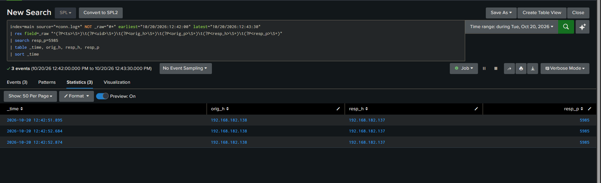
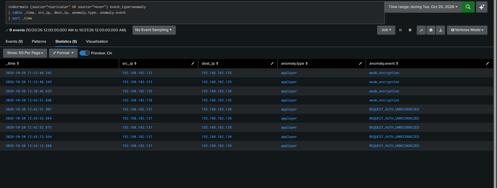
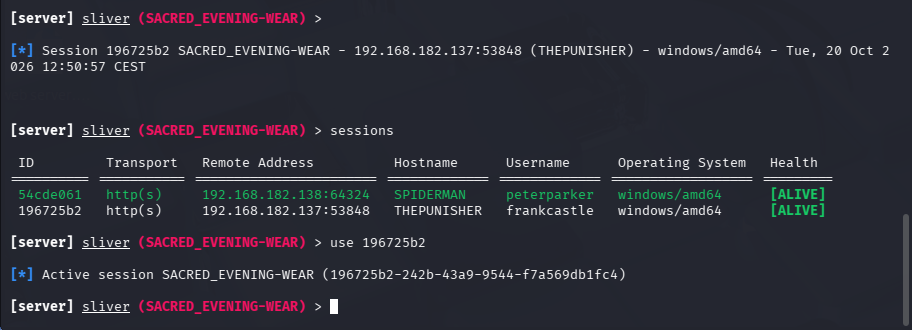

# CASE-04 — Lateral movement over WinRM

| | |
| --- | --- |
| Alert | Zeek `conn.log` port 5985 east-west, Suricata `REQUEST_AUTH_UNRECOGNIZED` |
| Fired | 20 Oct 2026, 12:42 |
| Severity | High |
| MITRE | [T1021.006 — Windows Remote Management](https://attack.mitre.org/techniques/T1021/006/) |
| Verdict | True positive. Workstation-to-workstation pivot with a stolen ticket. |
| Handed from | [CASE-03](CASE-03-pass-the-ticket.md) |

## 1. What the alert showed

Three completed connections from `192.168.182.138` (SPIDERMAN) to `192.168.182.137`
(THEPUNISHER) on TCP 5985.



Suricata flagged `REQUEST_AUTH_UNRECOGNIZED` on the same exchange.



**That Suricata event corroborates, it does not detect.** It is not a WinRM signature and
nobody wrote it. It is Suricata's built-in HTTP anomaly for an `Authorization` header its
parser does not recognise, which is what WS-Management's `Negotiate`/Kerberos auth looks
like to it. Legitimate WinRM administration produces the same anomaly, so on its own it is a
protocol-oddity note with no verdict in it. What makes this alertable is the `conn.log` pair:
workstation to workstation on 5985, which is a path that should never carry traffic in this
estate. The anomaly is useful as the second source agreeing on the timing, and that is all it
is being claimed for here.

## 2. Questions

1. Do these two workstations normally talk to each other on 5985?
2. Which account authenticated, and with what?
3. Why WinRM and not SMB or WMI, which are the usual choices?
4. What ran on the destination once the session opened?

## 3. Queries

Network view, which is where this was seen first:

```spl
index=main source="*conn.log*" NOT _raw="#*"
| rex field=_raw "^(?P<ts>\S+)\t\S+\t(?P<orig_h>\S+)\t(?P<orig_p>\S+)\t(?P<resp_h>\S+)\t(?P<resp_p>\S+)"
| where resp_p="5985"
| stats count values(orig_h) as sources by resp_h
```

Endpoint view on the destination:

```spl
index=main host=THEPUNISHER EventCode=4624 Logon_Type=3
  earliest="10/20/2026:12:40:00" latest="10/20/2026:12:50:00"
| table _time, Account_Name, Workstation_Name, Source_Network_Address, Authentication_Package
```

What the session executed:

```spl
index=main host=THEPUNISHER source="WinEventLog:Microsoft-Windows-Sysmon/Operational" EventCode=1
| search ParentImage="*wsmprovhost.exe"
| table _time, Image, CommandLine, User
```

## 4. Findings

| | |
| --- | --- |
| Source | `192.168.182.138` (SPIDERMAN) |
| Destination | `192.168.182.137` (THEPUNISHER) |
| Port | 5985 (WinRM, HTTP) |
| Connections | 3, states SF |
| Authentication | Kerberos, using the ticket injected in CASE-03 |
| Tooling | `Invoke-Command -ComputerName THEPUNISHER -Authentication Kerberos` |

**The firewall mesh decided the route.** The as-built baseline blocks SMB between the two
workstations and blocks WMI from the attacker on every host. It does not block WinRM
east-west. The attack did not get through the controls, it went around them to the one lane
that was open.

| Host | Blocks inbound |
| ---- | -------------- |
| HYDRA-DC | Kali to SMB, Kali to WMI |
| THEPUNISHER | SPIDERMAN to SMB, Kali to WMI |
| SPIDERMAN | THEPUNISHER to SMB, Kali to WMI |

That is the useful result for a defender: prevention narrowed the attack surface to a
single predictable path, and the detection layer was watching that path. Narrowing is worth
doing even when it does not block, provided something watches what is left open.

**Workstation-to-workstation WinRM has no legitimate reason here.** Administrative WinRM
normally originates from a management or jump host. This lab has none, which is exactly why
the pivot is visible. In an estate that does have one, the detection has to carry an
approved-source list or it alerts on every admin session. The shipped rule says so.

**The endpoint log alone would have been weaker.** A `4624` type 3 with Kerberos from
another workstation is suspicious, but it looks like ordinary network authentication. The
port and the direction are what make it unambiguous, and those come from the network layer.



## 5. Verdict

True positive. The stolen `SQLService` ticket authenticated a WinRM session from one
workstation to another, and a second C2 session opened on the destination.

## 6. What happened next

With a session on THEPUNISHER, the attacker read LSASS memory. Handed off as
[CASE-05](CASE-05-lsass-access.md).

## 7. Recommendations

Containment:

1. Isolate both endpoints. There are now two implants, not one.
2. Review every `4624` type 3 to THEPUNISHER from a workstation source in the window.
3. Check for WinRM sessions to any other host from either endpoint.

Detection tuning:

4. The shipped Zeek rule needs an approved-source list before it means anything in an
   estate with a jump host. Without it the title says east-west but the rule matches all
   WinRM. See [`detections/sigma/v3_ndr.yml`](../../detections/sigma/v3_ndr.yml).
5. Pair the network signal with `4624` type 3 plus `Authentication_Package=Kerberos` on the
   destination, so the alert carries the account name the network layer does not see.
6. Alert on `wsmprovhost.exe` spawning anything other than the expected administrative
   tooling.

Hardening:

7. Keep WinRM east-west open and monitored rather than closing it, if the alternative is
   pushing the attacker onto a path nothing watches. That is the choice made here, and it
   is only defensible while the detection exists.
8. Restrict WinRM to named management hosts through the firewall GPO, so the approved-source
   list is enforced rather than only alerted on.
9. Credential Guard on both endpoints raises the cost of the ticket injection that made this
   session possible.
